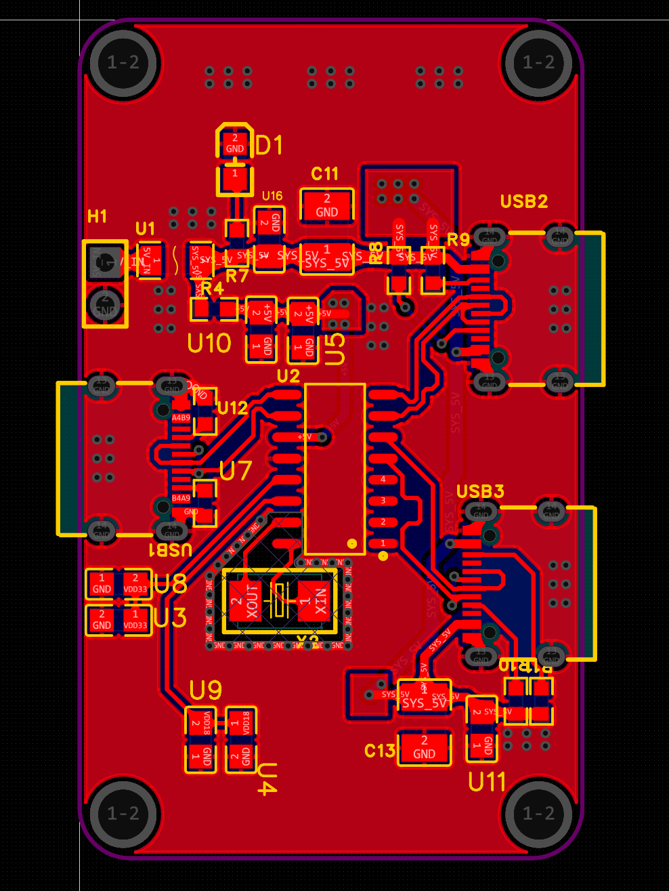
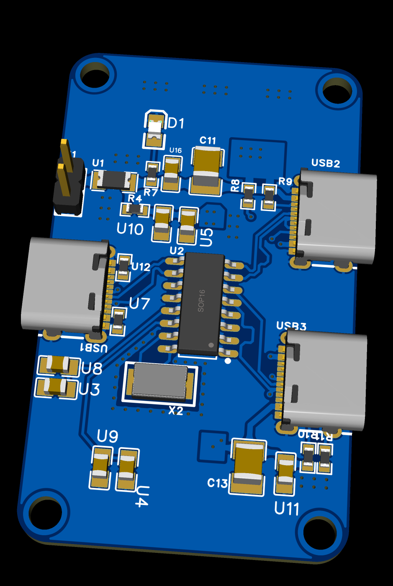

# 陈洛良｜嵌入式与机器视觉项目作品集

福建师范大学 · 电子信息工程 · 2027 届本科

[13313920603@163.com](mailto:13313920603@163.com) ｜ 意向城市　厦门（优先），福建其他城市及省外均可

这里整理了我的本科竞赛、实习项目和毕业设计，涉及 K230 端侧视觉、STM32 串口通信与 HAL 库开发、嵌入式汇编基础、ESP32-S3 蓝牙通信，以及 Radxa 上的 Linux 车端控制。

本仓库仅收录我完成的代码。2026 电赛 H 题的红外检测和小车行驶控制由队友完成，相关代码不在本仓库。

## 项目速览

| 项目 | 主要工作 | 成果与资料 |
| --- | --- | --- |
| [实习项目](#实习项目--智能玩具小车) · 智能玩具小车 | BLE 通信、Radxa Linux 车控、前后摄联调、USB-C 扩展坞 PCB 设计 | 附车端控制、摄像头和座椅端源码 |
| [2026 电赛 H 题](./2026-电赛/) · 车载平衡滚球运动控制系统 | 负责钢球视觉与通信测试，参与步进执行和 PID 联调 | 附视觉代码、通信实验和整车照片 |
| [毕业设计（在研）](#毕业设计在研--彩色图像无损压缩系统) · 彩色图像无损压缩系统 | 实现从 RGB 像素读取、预测和上下文建模到算术编解码的完整流程 | 样图 PCA 为 37,234 字节，解压 PNG 与基准逐字节一致 |
| [2025 电赛 E 题](./25%20电赛/) · 简易自行瞄准装置 | K230 靶心定位、UART 坐标打包与 STM32 接收联调 | 附视觉脚本、8 字节串口帧说明和调试视频 |

## 实习项目 · 智能玩具小车

使用者在座椅端踩踏板、打方向和换挡，车端根据这些输入驱动车辆，并向浏览器提供与行驶方向对应的摄像头画面。我主要做座椅端到车端的 BLE 通信、Linux 车端控制和前后摄联调，也针对无线充电接收端最高约 4.2 V 的输出设计了 Boost 升压电路。三维结构建模由团队其他成员完成。

```text
踏板 / 方向盘 / 挡位 → ESP32-S3 → BLE Notify → Radxa ZERO 3 → PWM / GPIO → 电机和舵机
                                              └─ 挡位状态 → 摄像头进程 → HTTP MJPEG → 浏览器
```

### 座椅端采样与 BLE 通信

ESP32-S3 在 Arduino 环境下采集油门、刹车和转向电压，每 20 ms 更新一次滤波值，每 100 ms 上报油门、刹车、转向、倒车和前进五个字段。Radxa 用 Bleak 订阅通知，解析字段、更新挡位，并用单调时钟记录最近一次有效数据的接收时间。

下面是 ESP32-S3 组包和发送通知的源码片段。[座椅端源码](./实习项目/esp32%20座椅部分/esp32test3_copy/esp32test3_copy.ino)

```cpp
snprintf(
  packet,
  sizeof(packet),
  "%.3f,%.3f,%.3f,%d,%d",
  acceleratorVoltage,
  brakeVoltage,
  steeringVoltage,
  reverseState,
  forwardState
);

voltageCharacteristic->setValue(
  reinterpret_cast<uint8_t *>(packet),
  strlen(packet)
);

if (bleConnected) {
  voltageCharacteristic->notify();
}
```

### Linux 车端控制与失联停车

Radxa 用 GPIO 控制 TB6612 的电机方向，用硬件 PWM 调整电机占空比和舵机脉宽。前进和倒车互换时，第一次触发先进入空挡，再次触发才挂入目标方向。控制循环按 20 ms 休眠间隔运行，电机逐步加减速，舵机逐步趋近目标角度。实际循环间隔还受代码执行耗时和 Linux 调度影响。

下面是 BLE 模式的控制分支。断连或连续 2 秒未收到有效通知时，程序将目标挡位切到空挡、目标速度置零，并让舵机逐步回中。[车端控制源码](./实习项目/radxa%20小车部分/radxa_vehicle_control.py)

```python
fresh = (
    ble_state.connected
    and ble_state.last_data_time > 0
    and now - ble_state.last_data_time <= DATA_TIMEOUT_SECONDS
)
if fresh:
    target_direction = ble_state.direction
    target_speed, _ = pedal_target_speed()
    if target_direction == 0:
        target_speed = 0.0
    target_angle = steering_to_angle(ble_state.steering)
    speed_rate = MOTOR_CHANGE_RATE_PER_SECOND
    status = "esp32"
else:
    target_direction = 0
    target_speed = 0.0
    target_angle = 0.0
    speed_rate = MOTOR_CHANGE_RATE_PER_SECOND
    status = "failsafe"
```

### 前后摄切换与浏览器预览

车控程序通过状态文件发布挡位。独立的摄像头进程读取挡位，倒车时切换后摄，其余状态使用前摄。OpenCV 采集并编码 JPEG，Flask 通过 `/video.mjpg` 持续返回画面，浏览器可以直接预览。

```python
def selected_camera() -> tuple[str, str]:
    if read_direction() == -1:
        return REAR_DEVICE, "后摄（倒车）"
    return FRONT_DEVICE, "前摄"
```

[摄像头预览源码](./实习项目/radxa%20小车部分/radxa_camera_web.py) · [初始化文档](./实习项目/radxa%20小车部分/初始化.docx) · [实习项目目录](./实习项目/)

### USB-C 扩展坞 PCB

我为车端设计并绘制了一块 USB-C 扩展坞 PCB，用一个上行口连接主机，并引出两个下行口接外设。

- **数据连接**　一个 USB-C 上行口的 USB 2.0 信号接入 SL2.1A 集线器芯片，再从芯片引出两路 D+/D− 到两个 USB-C 下行口。[SL2.1A 数据手册](https://datasheet.lcsc.com/lcsc/1811151645_CoreChips-SL2-1A_C192893.pdf)
- **独立供电**　板上预留一个 2 Pin 电源接口，接入独立 5 V 电源，为两个下行 USB-C 口的 VBUS 供电。下行供电按总电流约 1 A 设计，在供电支路串联一颗 1.5 A 快恢复保险丝用于过流保护。

PCB 左侧的 USB1 是上行口，右侧的 USB2 和 USB3 是下行口，H1 是独立电源入口。

| PCB 布线图 | PCB 3D 视图 |
| :---: | :---: |
|  |  |

## 2026 电赛 H 题 · 车载平衡滚球运动控制系统

小车行驶时，摄像头跟踪轨道上的钢球，控制端根据位置反馈调整轨道倾角。我主要负责钢球视觉模块，并参与步进电机和 PID 联调。


### 钢球识别与位置反馈

- 采集并标注不同视角下的钢球图像，迭代 YOLO 模型。将训练产物从 PyTorch 导出为 ONNX，再通过 WSL 中的 Docker 工具链转换为 K230 使用的 `.kmodel`。
- 基于 K230 庐山派的 CanMV 示例适配 AI2D 预处理和 LCD 显示。后处理按置信度筛选候选框，保留分数最高的钢球框，用框中心像素坐标作为位置反馈。

源码中的后处理先用置信度阈值筛选候选框，再取分数最高的钢球框。[K230 钢球检测脚本](./2026-电赛/k230%20钢珠yolo/yolov12_已完成%20-%20副本.py)

```python
# 按置信度排序，保留置信度最高的钢珠
det_res.sort(key=lambda x:x[-1], reverse=True)
# 如果有多个检测框，保留置信度最高的一个
det_res_single = det_res[:1] if det_res else []
```

### 无线通信与图像回传

用 GPIO 模拟 SPI 驱动 nRF24L01，验证 32 字节定长载荷收发及发送状态检查。图像回传早期使用 TCP 发送 JPEG 帧，断线重连时出现帧解析错位，后来改用 UDP 测试。[nRF24L01 测试源码](./2026-电赛/无线通信.py)

### 赛场结果与复盘

第 4～6 问未完成，行进中的钢球位置未能稳定在 ±1 cm 范围内。

1. **视觉更新慢、反馈滞后**　按赛场复盘，K230 球位识别约 10 fps，约每 100 ms 更新一次，端到端延迟估计超过 100 ms。漏检和半球检测还会让位置跳变。补拍多角度样本并改进标注后，识别更稳定，反馈延迟仍限制了调节速度。
2. **驱动阻塞，停步后保持力矩下降**　步进驱动以 `delay_us` 阻塞等待每次换相，步进过程中无法在同一执行流程内及时刷新控制指令。步进结束后程序主动释放线圈，摆杆受载时可能偏离目标角度。若继续迭代，会用定时器做非阻塞换相，并在电流和温升允许的范围内维持停步励磁。
3. **行进扰动使球位更难稳定**　摆杆倾角影响钢球加速度，车体加减速和振动也会扰动球位。联调时根据钢球偏离和回摆表现调整 PID，但粗估环路带宽只有 1–2 Hz，低于复盘时希望达到的 5–10 Hz，两组数字均为工程估计。小倾角下还遇到静摩擦导致的起滚死区，曾用短时抖动辅助起滚。

[部署模型](./2026-电赛/k230%20钢珠yolo/best.kmodel) · [整车照片](./2026-电赛/小车图片/)

## 毕业设计（在研） · 彩色图像无损压缩系统

在 Windows 桌面工具中选择一张图片，程序将像素压缩为自定义 `.pca` 文件。解压时读取该文件，重新生成 PNG。压缩与解压流程由 Python 实现，界面使用 Tkinter。

```text
导入图片 → 读取 RGB / RGBA 像素 → YCoCg-R 可逆颜色变换
        → 逐通道 MED 预测 → 上下文建模 → 自适应算术编码 → .pca

.pca → 读取文件头 → 算术解码与逐像素重建 → 逆颜色变换 → 校验并输出 PNG
```

### 压缩流程

1. **导入图片并读取像素**　使用 Pillow 按文件内容识别格式，解码得到 8 位 RGB 像素。有透明度的图像使用 RGBA。程序先保存一份标准 PNG，作为比较文件大小和验证解压结果的基准。
2. **可逆颜色变换**　把 RGB 转换为 Y、Co、Cg 三个分量，利用颜色通道之间的相关性。Y 表示亮度相关信息，Co 和 Cg 表示颜色差。Alpha 透明度保持原值，作为独立通道编码。
3. **预测编码**　每个通道按行逐像素处理。MED 预测器根据左、上、左上三个已处理像素预测当前值，再用实际值减去预测值，得到要编码的残差。
4. **上下文建模**　根据邻域像素的局部变化强度，将当前位置归入 9 类上下文之一。每类有自己的残差频次表，让变化平缓的区域和边缘区域分别学习各自的残差分布。
5. **算术编码与文件封装**　按当前上下文的频次表对残差进行自适应算术编码，每编码一个残差就更新对应的频次表。最后将图像尺寸、通道信息、编解码参数、CRC32 和各通道码流一起写入 `.pca` 文件。

### 解压与验证

解压端读取文件头，使用已重建的邻域像素选出与编码时相同的上下文。算术解码得到残差，再把它加到 MED 预测值上，逐像素恢复各通道。最后做 YCoCg-R 逆变换还原 RGB，合并透明度通道（如有），校验像素并输出 PNG。

以一张 193×135 的彩色样图为例，标准 PNG 为 41,080 字节，压缩后的 PCA 为 37,234 字节，约小 9.4%。解压生成的 PNG 与标准 PNG 基准逐字节一致。

## 2025 电赛 E 题 · 简易自行瞄准装置

K230 从图像中提取矩形靶标的四个角点，用两条对角线的交点定位靶心，再把靶心的像素坐标 `x`、`y` 发给 STM32，供瞄准控制使用。下面以仓库里的坐标帧版本为例。

### K230 发送与 STM32 接收流程

1. **接线**　把 K230 的 UART2 TX 接到 STM32 所用串口的 RX，两板共地，确认两端 I/O 电平相容。需要双向通信时，再把 STM32 TX 接到 K230 RX。
2. **配置 K230**　通过 FPIOA 把 IO11 映射为 `UART2_TXD`，IO12 映射为 `UART2_RXD`。脚本以 `UART(UART.UART2, 115200)` 初始化，其余串口参数使用 CanMV 默认值，即 8 个数据位、无奇偶校验、1 个停止位（8N1）。[CanMV UART API](https://www.kendryte.com/k230_canmv/zh/v1.2/api/machine/K230_CanMV_UART%E6%A8%A1%E5%9D%97API%E6%89%8B%E5%86%8C.html)
3. **初始化 STM32 串口**　通过 RCC 使能所用 GPIO 端口和 USART 外设的时钟，再按芯片型号配置 RX 引脚的 USART 功能。将 USART 设置为异步接收、115200、8N1，无硬件流控。使用中断接收时，还要使能 USART 接收中断并配置 NVIC。[ST 串口初始化与接收说明](https://wiki.st.com/stm32mcu/wiki/Getting_started_with_UART)
4. **打包发送**　K230 将靶心坐标转为整数，把每个坐标拆成高、低两个字节，按高字节在前写入发送缓冲区，最后用 `uart2.write(bytes(rx_order))` 发出完整的 8 字节二进制帧。
5. **同步与解析**　STM32 从字节流中寻找 `AA AA`，找到后收满剩余 6 字节，再检查末尾是否为 `FF FF`。通过后，把 `x` 和 `y` 分别按高低字节组合成 16 位无符号数，再交给瞄准控制。帧尾不符时重新寻找帧头。

仓库收录了 K230 发送端脚本。上面的 STM32 初始化和解析是与该帧格式配套的接收流程。

### 8 字节坐标帧

| 字节位置 | 内容 | 含义 |
| --- | --- | --- |
| 0–1 | `AA AA` | 固定帧头 |
| 2–3 | `X_H X_L` | 靶心横坐标，高字节在前 |
| 4–5 | `Y_H Y_L` | 靶心纵坐标，高字节在前 |
| 6–7 | `FF FF` | 固定帧尾 |

例如靶心位于 `(400, 240)` 时，串口线上发送 `AA AA 01 90 00 F0 FF FF`。这里的帧头和帧尾是应用层定义的字节标记。UART 的停止位属于单个字节的硬件传输格式。当前坐标帧的求和校验代码处于注释状态，帧内没有独立校验字段。

以下是 K230 脚本的组帧与发送代码，摘录有效语句。函数形参 `steps` 在调用处传入的是靶心横坐标。[坐标帧发送源码](./25%20电赛/2025%20e题目%20-%20一版本，步进电机.py)

```python
rx_order = [0xAA, 0xAA,  0x00, 0x00, 0x00, 0x00, 0xFF, 0xFF]

def send_order(steps,y):
    rx_order[2] = (steps // 256) % 256
    rx_order[3] = steps % 256
    rx_order[4] = (y // 256) % 256
    rx_order[5] = y % 256
    uart2.write(bytes(rx_order))
```

[另一版靶标定位脚本](./25%20电赛/2025%20e题目.py) · [实验照片](./25%20电赛/picture/) · [调试视频](./25%20电赛/vedio/)

## 运行环境

- **K230 视觉脚本**使用 CanMV 固件。H 题检测脚本还需要配套的 CanMV 示例库，并默认从 `/sdcard/best.kmodel` 加载模型。
- **实习小车**的 ESP32-S3 代码使用 Arduino 环境。Radxa 端依赖 Linux 的 PWM、GPIO 和蓝牙接口，接线及板端配置见项目初始化文档。
