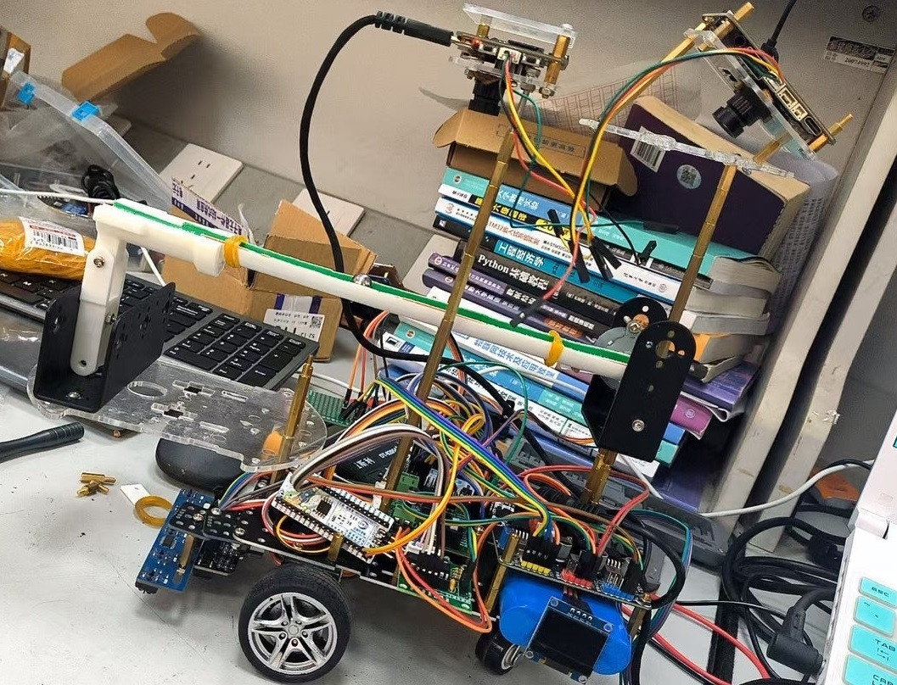

# 陈洛良｜嵌入式与机器视觉项目作品集

福建师范大学 · 电子信息工程 · 2027 届本科

这里整理了我的本科竞赛和实习项目，涉及 K230 端侧视觉、ESP32-S3 蓝牙通信，以及 Radxa 上的 Linux 车端控制。

## 项目速览

| 项目 | 主要工作 | 成果与资料 |
| --- | --- | --- |
| [2026 电赛 H 题](./2026-电赛/) · 车载平衡滚球运动控制系统 | 三人组组长，负责钢球识别和模型部署，参与 PID 调试 | 福建赛区三等奖，附模型和整车照片 |
| [实习项目](./小车开发代码文件/) · 智能玩具小车 | 座椅端与车端通信、车端控制与摄像头画面联调 | 附 ESP32-S3、Radxa 源码及初始化说明 |
| [2025 电赛 E 题](./25%20电赛/) · 简易自行瞄准装置 | 矩形靶标识别、中心定位与串口指令测试 | 附视觉脚本、照片和调试视频 |

## 2026 电赛 H 题 · 车载平衡滚球运动控制系统

小车行驶时，摄像头跟踪轨道上的钢球，控制端根据位置反馈调整轨道倾角。我们三人组队，我担任组长，主要负责钢球视觉模块，并参与步进电机和 PID 联调。



**我做的工作**

- 采集并标注不同视角下的钢球图像，迭代 YOLO 模型。将训练产物从 PyTorch 导出为 ONNX，再通过 WSL 中的 Docker 工具链转换为 K230 使用的 `.kmodel`。
- 基于 K230 庐山派的 CanMV 示例适配 AI2D 预处理和 LCD 显示。后处理按置信度筛选候选框，保留分数最高的钢球框，用框中心像素坐标作为位置反馈。
- 参与视觉与步进电机联调，根据钢球偏离和回摆的表现调整 PID 参数。

**结果与复盘**

比赛中，动态平衡环节未达到 1 cm 误差要求。早期模型会漏检，或只框到半颗钢球，导致中心坐标跳变并影响速度估计。补拍多角度样本、修正标注并迭代模型后，识别更稳定。若继续优化，我会优先量化中心点误差和丢帧率，再根据测量结果调整反馈处理和控制参数。

[K230 钢球检测脚本](./2026-电赛/k230%20钢珠yolo/yolov12_已完成%20-%20副本.py) · [部署模型](./2026-电赛/k230%20钢珠yolo/best.kmodel) · [串口测试](./2026-电赛/10_串口通信.py) · [整车照片](./2026-电赛/小车图片/)

## 实习项目 · 智能玩具小车

座椅端采集油门、刹车和转向输入，经 BLE 发送到车端。Radxa ZERO 3 在 Linux 上解析输入，通过 PWM 和 GPIO 控制电机与转向舵机，并提供前后摄像头画面。

```text
座椅端 ESP32-S3 → BLE Notify → Radxa ZERO 3 → PWM / GPIO → 电机与舵机
车端 USB 摄像头 → OpenCV + Flask → HTTP MJPEG → 浏览器
```

- **座椅端**　ESP32-S3 采集模拟量和方向输入，通过 BLE Notify 上报。
- **车端控制**　Python 程序用 Bleak 接收数据，通过硬件 PWM 和 GPIO 驱动车辆，处理加减速、舵机限幅以及接收超时停车。
- **画面预览**　OpenCV 采集 USB 摄像头图像，Flask 提供浏览器预览。车端控制程序向视频进程传递方向状态，用于切换前后视角。

[ESP32-S3 座椅端](./小车开发代码文件/esp32%20座椅部分/esp32test3_copy/esp32test3_copy.ino) · [Radxa 车端控制](./小车开发代码文件/radxa%20小车部分/radxa_vehicle_control.py) · [摄像头预览](./小车开发代码文件/radxa%20小车部分/radxa_camera_web.py) · [初始化文档](./小车开发代码文件/radxa%20小车部分/初始化.docx)

## 2025 电赛 E 题 · 简易自行瞄准装置

这一部分记录了矩形靶标定位和串口联调实验。K230 端对图像做灰度化和二值化，提取矩形的四个角点，再用两条对角线的交点定位靶心。串口联调脚本根据靶心在画面中的偏移生成方向指令，供控制端测试。

[靶标定位脚本](./25%20电赛/2025%20e题目.py) · [串口联调脚本](./25%20电赛/2025%20e题目%20-%20一版本，步进电机.py) · [实验照片](./25%20电赛/picture/) · [调试视频](./25%20电赛/vedio/)

## 运行环境

- **K230 视觉脚本**使用 CanMV 固件。H 题检测脚本还需要配套的 CanMV 示例库，并默认从 `/sdcard/best.kmodel` 加载模型。
- **实习小车**的 ESP32-S3 代码使用 Arduino 环境。Radxa 端依赖 Linux 的 PWM、GPIO 和蓝牙接口，接线及板端配置见项目初始化文档。
